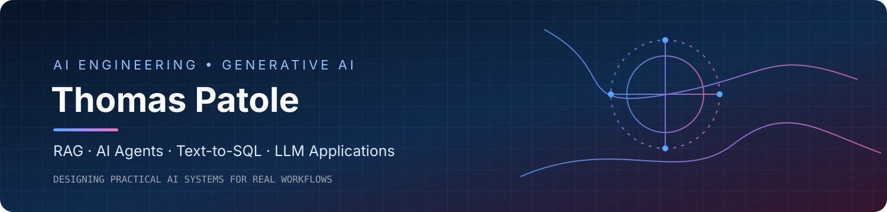
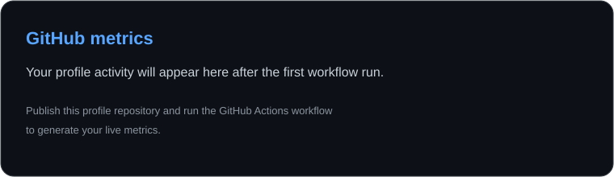
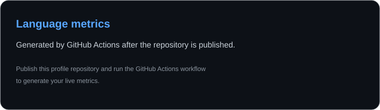

 

 

 

 

---

## 👋 About Me

I'm **Thomas Patole**, a **Generative AI Engineer** focused on building practical AI applications that connect large language models with real business workflows. I enjoy turning complex problems into reliable, useful systems—from retrieval-augmented generation to tool-using agents and natural-language data interfaces.

- 🤖 **Generative AI:** LLM applications, prompt engineering, RAG, agentic workflows, and evaluation.
- 🔎 **Knowledge retrieval:** document ingestion, chunking, embeddings, semantic search, and vector databases.
- 🧰 **AI engineering:** Python APIs, LangChain, LangGraph, database integrations, and production-minded workflows.
- 📊 **Data applications:** Text-to-SQL, structured-data analytics, and interactive visualizations.
- 🏗️ **Industry use cases:** RFP management, manufacturing copilots, and AI-powered technical image generation.
- ✍️ **Knowledge sharing:** I write about AI engineering, RAG, agents, and developer tools.

**My focus:** build AI systems that are useful, grounded, observable, and maintainable—not just impressive demos.

---

## 🧠 Core Stack

  

| Area | Tools and concepts |
|---|---|
| Programming | Python, SQL, Java |
| Generative AI | LLMs, prompt engineering, structured outputs, tool/function calling |
| RAG & search | Document parsing, chunking, embeddings, reranking, hybrid retrieval |
| Agents | LangGraph, LangChain agents, tool orchestration, guardrails |
| Data & databases | PostgreSQL, SQL Server, MySQL, MongoDB, pandas, NumPy |
| APIs & deployment | FastAPI, Streamlit, Docker, Git, Azure, AWS |
| Evaluation & reliability | Retrieval evaluation, SQL validation, logging, error handling |

---

## 🚀 Featured Projects

<table>
<tr>
<td width="50%" valign="top">

### 📄 RFP Management Assistant
An LLM-powered workflow for understanding large RFP documents, extracting requirements, producing structured summaries, and supporting proposal preparation.

**Focus:** RAG · document processing · prompt engineering

</td>
<td width="50%" valign="top">

### 🏭 Manufacturing Copilot
A natural-language analytics assistant that connects LLMs to structured databases to generate SQL, answer operational questions, and support data visualization.

**Focus:** Text-to-SQL · SQL validation · analytics

</td>
</tr>
<tr>
<td width="50%" valign="top">

### 🧩 Multi-Database Text-to-SQL
An architecture direction for retrieving relevant schema context, linking tables and relationships, generating dialect-aware SQL, and validating queries before execution.

**Focus:** schema linking · relationship graphs · safe SQL

</td>
<td width="50%" valign="top">

### 🎨 AI-Powered Technical Image Generation
A generative AI concept for creating manufacturing-oriented technical diagrams and schematics from natural-language descriptions.

**Focus:** generative models · prompt design · industry workflows

</td>
</tr>
</table>

> Project descriptions summarize work and areas of focus. Add links to public repositories where available.

---

## 📡 Engineering Signals

<table>
<tr>
<td width="50%" align="center" valign="middle">

</td>
<td width="50%" align="center" valign="middle">

</td>
</tr>
</table>

---

## 📈 GitHub Metrics

<picture>
  <source media="(prefers-color-scheme: dark)" srcset="assets/card-stats-dark.svg">
  <source media="(prefers-color-scheme: light)" srcset="assets/card-stats-light.svg">
  
</picture>

 

*Metrics and cards refresh through GitHub Actions after the repository is published and workflows are enabled.*

---

## 📝 Writing & Learning

I share practical notes and explainers on topics such as:

- RAG architecture, chunking strategies, and retrieval evaluation
- Agentic AI, LangGraph, MCP, and tool-calling workflows
- Text-to-SQL, schema retrieval, and database-aware AI systems
- Prompt engineering and production-oriented AI engineering

Read more on [Medium](https://medium.com/@thomaspatole19).

---

## 🤝 Connect

Interested in Generative AI, RAG, agentic systems, or AI engineering? Let's connect.

- **GitHub:** [@NextIn035846](https://github.com/NextIn035846)
- **LinkedIn:** [Thomas Patole](https://www.linkedin.com/in/thomas-patole/)
- **Medium:** [@thomaspatole19](https://medium.com/@thomaspatole19)

  Build thoughtfully. Ship responsibly. Keep learning. ✨

